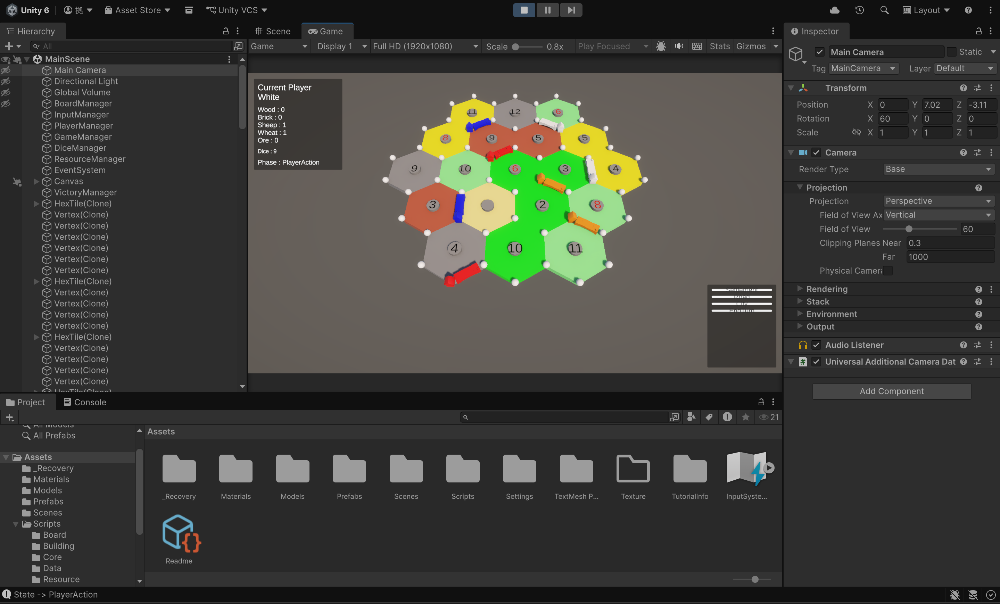

# Frontier Conquest 3D

**Unity 6 / C# で開発する、3Dストラテジーボードゲーム**

六角形の土地を舞台に、資源の獲得・開拓・建設を通じて勢力を拡大していく3Dストラテジーボードゲームです。

ボードゲーム「カタン」の基本システムを参考にしながら、盤面の自動生成、難易度によるゲーム展開の変化、盗賊による妨害などを実装しています。

単にルールを再現するだけでなく、**アルゴリズムによる盤面設計、State Machineによるゲーム進行管理、3D空間での直感的な操作性**を重視して開発しています。

---

## 🎮 Game Overview

プレイヤーは六角形の土地を開拓し、資源を獲得しながら自分の勢力を拡大します。

主なゲーム要素：

- 資源の獲得
- 開拓地の建設
- 街道の建設
- 開拓地から都市へのアップグレード
- サイコロによる資源配布
- 盗賊による土地の封鎖と資源の強奪
- 勝利点の獲得

### 基本ゲームループ

```text
タイトル画面
    ↓
難易度選択
    ↓
ゲーム開始・盤面生成
    ↓
初期配置
    ↓
サイコロを振る
    ↓
資源獲得
    ↓
建設・交換などのアクション
    ↓
ターン終了
    ↓
次のプレイヤー
```

サイコロで「7」が出た場合は、通常のアクションとは異なる盗賊移動フェーズへ遷移します。

---

### 🕹️ Controls（操作方法）

| Input | Action |
|---|---|
| **Space** | サイコロを振る（RollDiceフェーズ） |
| **Left Click** | 開拓地・街道・都市の建設 / 盗賊の移動 |
| **WASD / Arrow Keys** | カメラの平行移動 |
| **Right Drag / Q, E** | カメラの水平回転 |
| **Mouse Wheel** | カメラのズームイン・ズームアウト |
| **R** | カメラ位置・角度のリセット |


---

## 🖥️ Game Screen

### ゲーム画面

<p align="center">
  
</p>

六角形の土地、開拓地、都市、街道などを3D空間上に配置し、盤面全体を見渡しながらプレイできる構成にしています。

---

## ✨ Main Features

### 1. 難易度別の盤面自動生成

本作では、盤面生成処理を `BoardGenerator` と `BoardData` に分離し、3種類の生成モードを実装しています。

| モード | 特徴 |
|---|---|
| Standard | 基本ルールに沿ったバランスを重視した盤面 |
| Challenging | 評価関数を利用し、資源の偏りや競争が生まれやすい盤面 |
| Random | 配置のランダム性を重視した盤面 |

#### Standard：ルールに基づく盤面生成

単純なランダム配置ではなく、配置条件を確認しながら盤面を生成します。

例えば、出目の確率が高い「6」と「8」が隣接しないようにするなど、基本ルールに沿ったバランス調整を行います。

#### Challenging：評価関数による盤面選抜

生成した盤面を評価し、条件に応じた盤面を選抜する仕組みを実装しています。

資源の偏りや競争が生まれやすい配置など、盤面の特徴を評価することで、Standardとは異なるゲーム展開を目指しています。

#### Random：ランダム性を重視した生成

配置のランダム性を重視したモードです。毎回異なる盤面でプレイできるようにしています。

**技術的なポイント**

- 盤面生成ロジックと盤面データの分離
- 生成条件に基づく配置判定
- 評価関数による盤面のスコアリング
- 難易度に応じた生成方針の切り替え

### 2. 盗賊システムとゲーム状態の連動

サイコロで「7」が出た場合に、通常のアクションから `MoveRobber` ステートへ遷移する盗賊システムを実装しています。

主な機能：

- 盗賊の移動
- 盗賊が存在する土地の資源獲得ブロック
- 対象プレイヤーからの資源強奪
- 盗賊移動フェーズに応じた入力制御

`RobberManager` とゲームの状態管理を連携させることで、盗賊移動中に通常の建設処理が実行されないように制御しています。

また、`InputManager` のレイヤーマスクを利用し、フェーズに応じて入力対象を切り替える設計にしています。

**技術的なポイント**

ゲーム状態と入力処理を連動させることで、プレイヤーが実行できる操作を制限し、ルールの整合性を保つことを意識しています。

### 3. CameraRigによる3Dカメラ制御

ボードゲームとして盤面を見渡しやすくするため、親子ピボット構造を利用したカメラ制御を実装しています。

移動・水平回転・見下ろし角度・ズームをそれぞれ分離して制御することで、カメラ操作の役割を整理しています。

主な機能：

- 盤面を中心としたカメラ移動
- 水平方向の回転
- 見下ろし角度の調整
- ズームイン・ズームアウト
- 盤面中心への自動フォーカス
- カメラ位置のリセット

**技術的なポイント**

カメラの移動・回転・ズームを一つのTransformに集中させず、親子関係を利用して役割を分離しています。

これにより、操作ごとの座標計算やカメラ挙動を管理しやすい構成を目指しています。

### 4. タイトル画面とゲーム設定の引き継ぎ

ゲーム開始前にタイトル画面を表示し、プレイヤーが盤面の難易度を選択できるようにしています。

```text
TitleScene
    ↓
難易度選択
    ↓
GameSettings
    ↓
GameScene
    ↓
選択した設定で盤面生成
```

`GameSettings` を利用して、タイトル画面で選択した難易度をゲーム本編へ引き継ぎます。

これにより、シーン間のデータ連携と盤面生成処理を分離し、ゲーム開始時の設定を管理できる構成にしています。

---

## 🎮 Current Features

### Gameplay

- [x] タイトル画面
- [x] 難易度選択
- [x] 難易度設定のシーン間引き継ぎ
- [x] 六角形盤面の自動生成
- [x] 初期配置フェーズ
- [x] ターン制進行
- [x] サイコロによる資源配布
- [x] 開拓地建設
- [x] 街道建設
- [x] 開拓地から都市へのアップグレード
- [x] 盗賊の移動
- [x] 盗賊による資源獲得ブロック
- [x] 盗賊による資源強奪
- [x] 勝利点の管理

### Board Generation

- [x] Standardモード
- [x] Challengingモード
- [x] Randomモード
- [x] 盤面データと生成処理の分離
- [x] 6・8の隣接回避判定
- [x] 評価関数による盤面選抜

### Rule System

- [x] 建設可能判定
- [x] 道路接続判定
- [x] 建物の隣接禁止判定
- [x] 初期配置ルール
- [x] プレイヤーごとの資源管理
- [x] 盗賊移動フェーズの入力制御
- [x] ゲーム状態に応じた操作制限

### Camera

- [x] CameraRigによる親子ピボット構造
- [x] カメラ移動
- [x] 水平回転
- [x] 見下ろし角度調整
- [x] ズーム
- [x] 盤面中心へのフォーカス
- [x] カメラリセット

### 3D Assets

- [x] Blenderによるオリジナルモデル制作
- [x] BlenderからUnityへのモデル導入
- [x] Unity Prefabによるオブジェクト管理

---

# 🏗️ Architecture

## 1. Graph Structure

本作では、六角形の盤面を**グラフ構造**として設計しています。

六角形タイルだけで盤面を管理するのではなく、建設地点と道路を独立したオブジェクトとして扱い、それぞれの接続関係を保持しています。

| クラス | 役割 |
|---|---|
| `HexTile` | 六角形の地形タイル |
| `Vertex` | 建物を建設できる交点 |
| `Edge` | 街道を建設できる辺 |
| `HexBoard` | 盤面全体の生成・管理 |

```text
                 HexBoard
                    |
        +-----------+-----------+
        |           |           |
     HexTile      Vertex       Edge
                    |            |
                 Building       Road
                 /      \
          Settlement    City
```

この構造によって、以下の判定を盤面の接続関係から実装しています。

- 建設可能判定
- 建物の隣接判定
- 道路接続判定
- 資源配布判定

盤面の形状とゲームルールを結び付けることで、建設や資源配布などの処理を拡張しやすい構造を目指しています。

## 2. Board Generation

盤面生成では、生成処理と生成結果を分離しています。

| クラス | 役割 |
|---|---|
| `BoardGenerator` | 盤面の生成・配置条件の判定 |
| `BoardData` | 生成された盤面情報の保持 |
| Evaluator | 盤面の評価・スコアリング |

```text
難易度設定
    ↓
BoardGenerator
    ↓
盤面候補の生成
    ↓
配置条件の判定・評価
    ↓
BoardData
    ↓
ゲーム盤面へ反映
```

生成アルゴリズムを独立させることで、難易度や生成ルールを追加・変更しやすい構成にしています。

## 3. Responsibility Separation

ゲーム全体の処理を一つのクラスに集中させず、それぞれのクラスが異なる責務を持つように設計しています。

### GameManager

ゲーム全体の進行と状態遷移を管理します。

### PlayerManager

- 現在のプレイヤー管理
- ターン切り替え
- プレイヤー情報管理

### ResourceManager

- 資源の獲得
- 資源の消費
- 資源量の管理

### RobberManager

- 盗賊の移動
- 盗賊による土地の封鎖
- 資源強奪に関する処理

### InputManager

- プレイヤー入力の取得
- Raycastによるオブジェクト選択
- LayerMaskを利用した入力対象の制御

### CameraRig

- カメラ移動
- 回転
- 見下ろし角度
- ズーム
- フォーカス・リセット

このように、ゲーム進行・プレイヤー・資源・入力・カメラなどの役割を分離し、機能追加時の影響範囲を抑えることを意識しています。

## 4. State Machine

ゲーム進行はState Machineを利用して管理しています。

```text
InitialSettlement
        ↓
InitialRoad
        ↓
     RollDice
        ↓
    PlayerAction
        |
        +---- サイコロの出目が7
        |             ↓
        |         MoveRobber
        |             ↓
        |       PlayerAction
        |
        ↓
     EndTurn
        ↓
     RollDice
```

ゲーム状態に応じて、プレイヤーが操作できるオブジェクトや実行可能な処理を制御しています。

例えば、盗賊移動中には通常の建設操作を制限し、盗賊の移動が完了してから通常のアクションへ戻します。

**状態遷移と入力制御を連動させることで、ゲーム進行中の不正な操作やルールの破綻を防ぐ設計**を意識しています。

---

# 🎨 3D Modeling

ゲーム内で使用する六角形タイルや建物などの3DモデルをBlenderで制作しています。

```text
Blender
   ↓
3D Model
   ↓
FBX Export
   ↓
Unity
   ↓
Prefab
   ↓
Game Object
```

自作したモデルをUnityへ取り込み、Prefabとして管理することで、ゲーム内で再利用できるようにしています。

単に既存のオブジェクトを配置するのではなく、ゲームの世界観に合わせた3Dモデルの制作から実装まで一貫して取り組んでいます。

---

# 🛠️ Technologies

| Category | Technology |
|---|---|
| Game Engine | Unity 6 |
| Programming Language | C# |
| 3D Modeling | Blender |
| IDE | Visual Studio Code |
| Version Control | Git / GitHub |
| Architecture | Object-Oriented Design |
| Board Structure | Graph Structure |
| State Management | State Machine |
| Input | Unity Input System |

---

# 💡 Technical Challenges & Learning

## 1. 盤面生成とゲームバランスの両立

**課題**

単純なランダム配置では、資源や出目が偏り、ゲームバランスが大きく変わってしまう可能性があります。

**取り組み**

盤面生成処理を独立させ、Standardでは配置条件によるバランス調整、Challengingでは評価関数による盤面選抜を行う構成にしました。

**学んだこと**

ランダム性を扱う場合でも、条件判定や評価基準を設けることで、ゲーム体験を意識した生成処理を設計できることを学びました。

## 2. ゲーム状態と入力処理の整合性

**課題**

ゲームのフェーズによって実行できる操作が異なるため、入力処理とゲーム進行が独立していると、意図しない操作が発生する可能性があります。

**取り組み**

State Machineによる状態管理とInputManagerの入力制御を連携させ、状態に応じて操作対象を切り替える構成にしました。

**学んだこと**

ゲームルールを正しく実装するには、個々の機能だけでなく、ゲーム全体の状態と入力の関係を設計することが重要だと学びました。

## 3. 3Dカメラ操作の設計

**課題**

盤面を自由に見渡せる操作性と、見やすい視点を両立する必要がありました。

**取り組み**

CameraRigの親子ピボット構造を利用し、移動・回転・見下ろし角度・ズームを分離しました。

**学んだこと**

3D空間では、Transformの親子関係や座標系を意識して設計することで、複雑なカメラ操作を整理できることを学びました。

---

# 🤖 Use of Generative AI

開発では、主にテキストチャット形式のChatGPTを学習・実装補助として利用しています。

プログラミングを学びながら開発しているため、生成AIを単なるコード生成ツールとしてではなく、**実装方法やプログラムの仕組みを理解するための学習パートナー**として活用しています。

具体的には、以下の用途で利用しています。

- 実現したい機能に必要なコードや仕組みの調査
- 提示されたコードの役割や処理内容の理解
- クラス構成やデータ構造などの設計方針の相談
- エラーやバグの原因分析
- 自分で実装したコードの改善点の確認

AIエージェントについては、主にバグの解析など、局所的な問題解決に限定して使用しています。

提案されたコードや設計をそのまま採用するのではなく、内容を確認・理解し、実際に動作を確認しながら開発を進めています。

---

# 📚 Skills

### Programming

- オブジェクト指向設計
- State Machine
- グラフ構造
- 盤面生成アルゴリズム
- 評価関数によるスコアリング
- ゲームルール実装
- プレイヤー・ターン管理
- 入力制御

### Unity

- Scene / GameObject管理
- Prefab
- Layer / LayerMask
- Raycast
- Unity Input System
- Script設計
- 3Dカメラ制御

### 3D Production

- Blenderモデリング
- FBXエクスポート
- Unityへのモデル導入
- Prefab化

### Development

- Git / GitHub
- ブランチを利用した開発
- デバッグ・動作確認
- 生成AIを活用した学習・問題分析

---

# 🚀 Future Plans

現在の基本システムを土台に、ゲームとしての完成度と独自性をさらに高めていく予定です。

## Phase 1：基本ルールの拡張

- [x] 勝利点
- [x] 基本的な資源獲得・建設
- [x] 盗賊システム
- [ ] 資源交換・銀行取引
- [ ] 発展カード
- [ ] 港システム
- [ ] 最長交易路

## Phase 2：オリジナルゲームシステム

- [ ] 領地占領システム
- [ ] プレイヤー同士の戦闘
- [ ] 戦闘用ミニゲーム
- [ ] 領地に応じた資源獲得システム

## Phase 3：ゲームとしての完成度向上

- [ ] AIプレイヤー
- [ ] Save / Load
- [ ] オンライン対戦
- [ ] UI / UX改善
- [ ] 演出・アニメーションの強化

---

# 📈 Development Status

**🚧 開発中**

現在は、盤面の自動生成からゲーム進行、資源獲得、建設、盗賊システムまで、基本的なゲームサイクルを構成する機能を実装しています。

特に、盤面生成アルゴリズム、State Machine、CameraRigなど、ゲーム体験を支える内部設計にも取り組んでいます。

今後は基本ルールをさらに拡張し、領地占領や戦闘などの独自要素を追加することで、既存のボードゲームをベースにしたオリジナルの3Dストラテジーゲームとして完成させることを目指しています。

---

# 👤 Author

**Individual Project**

### Roles

- Game Planning
- Game Design
- Programming
- Algorithm Design
- 3D Modeling
- Unity Development

企画・ゲームルール設計・アルゴリズム設計・プログラミング・3Dモデリングまで、個人で担当しています。